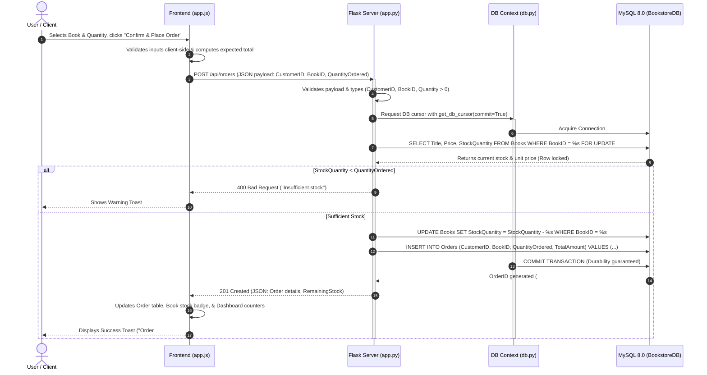

# 🏛️ Architecture & Project Structure Guide
### Online Bookstore Management System (`BookHaven`)
**Academic Evaluation Reference • 2nd-Year RDBMS Project**

---

## 📌 Repository Overview

This project adheres to the standard, idiomatic **Flask Monolithic Architecture**. All core components—presentation, business logic, data persistence, and runtime configuration—are organized predictably at the project root according to Flask's design conventions.

```
DBMS Project/
│
├── 📂 templates/                       # Presentation Layer: HTML Views
│   └── index.html                      # Single-Page Application (SPA) dashboard & modals
│
├── 📂 static/                          # Presentation Layer: Client-Side Assets
│   ├── 📂 css/
│   │   └── style.css                   # Custom responsive design system & UI components
│   └── 📂 js/
│       └── app.js                      # Client controller, AJAX fetch calls, DOM logic
│
├── 📄 app.py                           # Backend Application: REST API & Routing
├── 📄 config.py                        # Backend Configuration: Environment loader
│
├── 📄 init_db.sql                      # Database Schema: DDL, constraints, views, seeds
├── 📄 db.py                            # Database Access: Connection pool & cursor context
├── 📄 setup_database.py                # Database Utility: Automated SQL runner
│
├── 📄 .env                             # Environment Variables: Active DB credentials
├── 📄 .env.example                     # Configuration Template: Version control safe
├── 📄 requirements.txt                 # Dependencies: Python package manifest
├── 📄 run_portal.bat                   # Deployment: One-click Windows launch script
└── 📄 README.md                        # Documentation & Academic Viva Q&A
```

---

## 1. Architectural Breakdown by Layer

The project cleanly separates responsibilities into four distinct architectural tiers:

```
┌────────────────────────────────────────────────────────────────────────┐
│ 1. FRONTEND / PRESENTATION LAYER                                       │
│    • templates/index.html   • static/css/style.css   • static/js/app.js│
└──────────────────────────────────┬─────────────────────────────────────┘
                                   │ HTTP / JSON REST
┌──────────────────────────────────▼─────────────────────────────────────┐
│ 2. BACKEND APPLICATION LAYER                                           │
│    • app.py                 • config.py                                │
└──────────────────────────────────┬─────────────────────────────────────┘
                                   │ SQL Queries & ACID Transactions
┌──────────────────────────────────▼─────────────────────────────────────┐
│ 3. DATABASE ACCESS & PERSISTENCE LAYER                                 │
│    • init_db.sql            • db.py                  • setup_database.py│
└──────────────────────────────────┬─────────────────────────────────────┘
                                   │ Configuration & Runtime
┌──────────────────────────────────▼─────────────────────────────────────┐
│ 4. DEPLOYMENT & CONFIGURATION LAYER                                    │
│    • .env                   • requirements.txt       • run_portal.bat  │
└────────────────────────────────────────────────────────────────────────┘
```

### A. Frontend Layer (`templates/` & `static/`)
Responsible for the user experience, interface rendering, and asynchronous client-server communication.

- **`templates/index.html`**
  - The Single-Page Application (SPA) dashboard layout.
  - Contains semantic sections for **Dashboard Overview**, **Books Inventory**, **Orders**, **Customers**, and **RDBMS Views**.
  - Houses accessible modal dialogs for adding/editing books, placing orders, and registering customers.
- **`static/css/style.css`**
  - Modern CSS3 stylesheet utilizing custom CSS variables for uniform theming.
  - Implements Flexbox and CSS Grid for responsive layouts across desktop and mobile screens.
  - Provides custom styling for tables, metric counter cards, stock alert badges, and animated toast notifications.
- **`static/js/app.js`**
  - Vanilla JavaScript client engine (no heavy external frontend frameworks required).
  - Handles tab routing, modal lifecycle, dynamic dropdown population, and live order total calculations.
  - Communicates asynchronously with the backend using the browser's native `fetch()` API.

### B. Backend Application Layer (`app.py` & `config.py`)
Responsible for request handling, input validation, HTTP routing, and orchestrating business transactions.

- **`app.py`**
  - Serves as the central Flask server application.
  - Implements RESTful API endpoints for Books, Authors, Customers, Orders, and System Analytics.
  - Enforces input validation (price ranges, positive quantities, valid email formats).
  - Manages **ACID transactions** for orders, combining stock verification (`FOR UPDATE`), inventory deduction, and order placement into an atomic commit.
  - Formats responses into standardized JSON structures with correct HTTP status codes (`200 OK`, `201 Created`, `400 Bad Request`, `404 Not Found`, `409 Conflict`, `500 Server Error`).
- **`config.py`**
  - Loads environment variables from `.env` using `python-dotenv`.
  - Exposes a centralized `Config` class with typed parameters (`DB_HOST`, `DB_PORT`, `DB_USER`, `DB_PASSWORD`, `DB_NAME`, `FLASK_PORT`).

### C. Database & Persistence Layer (`init_db.sql`, `db.py`, `setup_database.py`)
Responsible for relational schema definition, data integrity, connection management, and query execution.

- **`init_db.sql`**
  - Complete MySQL 8.0 DDL and DML script.
  - Defines four relational tables (`Authors`, `Customers`, `Books`, `Orders`) with Primary Keys, Foreign Keys, `CHECK` constraints, and Cascade behaviors (`ON DELETE CASCADE` vs `ON DELETE RESTRICT`).
  - Defines performance indexes (`idx_books_author`, `idx_orders_customer`, etc.).
  - Defines SQL Views (`CustomerOrderSummary` and `BookSalesSummary`) combining multiple `JOIN`s, `GROUP BY`, and aggregate functions (`COUNT`, `SUM`, `AVG`, `COALESCE`).
  - Pre-populates realistic seed data for immediate demonstration.
- **`db.py`**
  - Database access layer implementing a resilient connection mechanism.
  - Provides a Python context manager `get_db_cursor(commit=False)` that automatically handles connection checkout, dictionary cursor generation, transaction commits, rollbacks on exceptions, and resource cleanup (`finally: cursor.close()`).
  - Features dual-driver resilience: detects and uses `mysql-connector-python` or falls back to `PyMySQL`.
  - Implements `check_db_health()` to report live MySQL server status and detect missing tables.
- **`setup_database.py`**
  - Standalone setup script allowing students and evaluators to initialize the schema with a single command (`python setup_database.py`) without needing to launch MySQL Workbench or manual CLI pipes.

### D. Deployment, Configuration & Runtime Layer (`.env`, `requirements.txt`, `run_portal.bat`)
Responsible for environment portability, dependencies, and execution.

- **`.env` / `.env.example`**
  - Isolates local environment secrets (MySQL passwords and ports) from application code.
- **`requirements.txt`**
  - Manifest of required Python packages (`Flask`, `mysql-connector-python`, `python-dotenv`, `PyMySQL`, `cryptography`).
- **`run_portal.bat`**
  - Windows batch script providing a one-click launcher that opens the browser to `http://127.0.0.1:5000` and starts the Flask server.

---

## 2. End-to-End Flow of Data (Request Lifecycle)

Here is how data flows through the system during a typical user action—**Placing an Order**:



### Detailed Lifecycle Steps:
1. **Trigger:** The user selects a book and enters a quantity in the modal. `static/js/app.js` calculates the live price preview and validates that quantity $\ge 1$.
2. **Dispatch:** `app.js` issues an asynchronous HTTP request using `fetch('/api/orders', { method: 'POST', body: JSON.stringify(...) })`.
3. **Route & Validation:** `app.py` receives the request at `@app.route('/api/orders', methods=['POST'])`, parses JSON via `request.get_json()`, and validates input formats.
4. **ACID Transaction:** 
   - `db.py` yields a dictionary cursor within a managed transaction block.
   - `app.py` queries `Books` using `FOR UPDATE` to lock the row and prevent race conditions.
   - If stock is sufficient, it executes an `UPDATE` to decrement `Books.StockQuantity` and an `INSERT` into `Orders`.
   - On success, `conn.commit()` commits both changes atomically; if an error occurs, `conn.rollback()` restores the initial state.
5. **Response:** Flask serializes the new order record using `serialize_response()` and returns HTTP `201 Created`.
6. **UI Update:** `app.js` receives the response, updates the orders table, refreshes the inventory view, increments the revenue counter, and renders a floating success toast.

---

## 3. Examiner Cheat Sheet: Why This Flat Root Structure?

When asked by an examiner: *"Why are `templates/`, `static/`, and `app.py` located directly in the root directory rather than split into nested `/backend` and `/frontend` folders?"*, use these key technical points:

- **1. Flask's Canonical Convention-over-Configuration:**
  - Flask is intentionally designed as a lightweight micro-framework. By default, `Flask(__name__)` automatically searches for templates in `./templates` and static assets in `./static` relative to the application entrypoint (`app.py`).
  - Keeping this standard structure avoids unnecessary boilerplate, custom path configurations (`template_folder='...'`), and fragile relative imports.

- **2. Elimination of Python Path (`sys.path`) Complications:**
  - In Python, nesting `app.py` inside a subfolder like `backend/app.py` creates module resolution issues when referencing root-level configuration files (`config.py`, `.env`) or sibling scripts.
  - The root structure guarantees that execution from the project root (`python app.py`) works uniformly across Windows, macOS, and Linux without requiring `PYTHONPATH` modifications.

- **3. Prevention of CORS (Cross-Origin Resource Sharing) Overhead:**
  - Splitting a project into separate standalone frontend and backend servers requires managing two distinct ports (e.g., frontend on 3000, backend on 5000), necessitating CORS middleware and proxy configuration.
  - Serving the Single-Page Application directly through Flask from a unified origin (`http://127.0.0.1:5000`) completely eliminates CORS vulnerabilities and browser pre-flight request overhead.

- **4. Strict Separation of Concerns Without Directory Bloat:**
  - Even within a flat root layout, the application enforces strict architectural layer separation:
    - Presentation is cleanly isolated in `templates/` and `static/`.
    - Business logic and routing live in `app.py`.
    - Data access and connection pooling are encapsulated in `db.py`.
    - Declarative database schema resides in `init_db.sql`.
  - This demonstrates clean software architecture while keeping the codebase lightweight and approachable for academic evaluation.

- **5. Portability & Instant Evaluation Readiness:**
  - For university lab exams and submissions, evaluators must be able to run the project immediately with standard commands (`pip install -r requirements.txt` and `python app.py`).
  - Zero build steps (no npm, webpack, or Vite build pipelines) means the project runs out-of-the-box on any grading machine.
